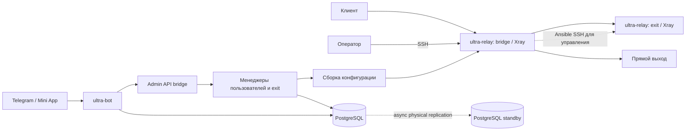

# Архитектура ultra

Это карта текущего устройства для выбора места изменения. Проверки описаны
в [руководстве разработки](development.md), создание региональных exit —
в [интеграции Vultr](vultr.md).
Сборка, параметры и эксплуатация описаны в [README](../README.md).
Границы транспортов и ограничения настроек — в [обходе цензуры](censorship-resistance.md).

Штатный путь развёртывания и обновления описан в [автоматизации](automation.md).
Исполнитель Ansible работает отдельно от relay; включение cloud-пути описано там же.
Текущий переход не переносит управление квотами и маршрутизацией в playbooks.

## Компоненты и потоки

В каждой установке главный сервер — `bridge`: на нём находятся публичный VPN-вход,
управление маршрутизацией и независимый исполнитель установки. `exit` всегда
остаётся отдельным узлом выхода трафика; он не становится главным сервером из-за
порядка подключения, SSH-маршрута или своего положения в конфигурации. Разделение
ролей задаётся планом установки и проверяется по коду [плана](../internal/installplan/render.go)
и [исполнителя](../cmd/ultra-install/plan_apply.go).
Оператор подключается к `bridge`; при управляемых операциях сам bridge-контроллер
открывает Ansible SSH-соединения к exit. Exit не служит промежуточным SSH-хостом
для входа оператора на bridge. Источник: [контроллер Ansible](../deploy/ansible/roles/controller)
и [исполнитель заданий](../internal/deployansible/service.go).

Подписка по умолчанию выдаёт VLESS URI. Явный `format=happ` включает экспериментальные
JSON-профили с клиентским выбором входа;
текущая публикация задаётся статическим `subscription_bridges` в spec: REALITY либо XHTTP/TLS. Синхронизация
независимых bridge и отдельная роль управления ещё не реализованы.
Контракт формата и границы клиентской проверки — [Happ](happ.md).
Публичные VPN-входы обслуживают только VLESS. Исторические SOCKS-записи и их
статистика сохраняются в БД, но создание, включение и экспорт таких доступов запрещены.
Внутренние SOCKS-прокси бота, WARP и локального клиента остаются.
Источники: [пользователи](../internal/db/repo_users.go), [Admin API](../internal/adminapi/server.go).

| Компонент | Ответственность | Основной источник |
| --- | --- | --- |
| `ultra-relay` | Роли bridge/exit, запуск встроенного Xray, управление состоянием bridge | [Точка входа](../cmd/ultra-relay/main.go) |
| `ultra-install` | Совместимая установка по SSH и независимый исполнитель заданий Ansible | [План CLI](../cmd/ultra-install/plan_cli.go), [применение](../cmd/ultra-install/plan_apply.go) |
| `ultra-bot` | Telegram long polling, Mini App, администраторы и уведомления | [Точка входа](../cmd/ultra-bot/main.go), [бот](../internal/bot/bot.go) |

Клиентский трафик проходит через bridge; конфигурация Xray определяет прямой выход,
блокировку или передачу на exit. Управление пользовательским трафиком и обмен с Telegram
идут разными путями и не должны смешиваться при изменении маршрутизации.

PostgreSQL primary работает на отдельном `database`; ограниченный async standby
работает на `bridge` в отдельном кластере. Relay и bot продолжают использовать
primary через bridge SSH-туннель, потому что запуск relay применяет миграции.
Реплика не продвигается автоматически и не заменяет зашифрованные backups.

Схема показывает основные отношения, а не все вызовы. API Mini App обращается к Admin API
для управления пользователями и exit, а состояние администраторов и уведомлений бот
получает через репозитории БД. См. [обработчики Mini App](../internal/bot/miniapp_api.go)
и [подключение зависимостей бота](../cmd/ultra-bot/main.go).

## Границы пакетов

- `internal/config` валидирует spec и строит JSON для Xray. Граница между моделью ultra
  и конфигурацией стороннего ядра проходит через `BuildBridgeXRayJSON` и `BuildExitXRayJSON`.
  См. [bridge builder](../internal/config/xray_bridge.go), [exit builder](../internal/config/xray_exit.go).
- `internal/proxy` владеет экземпляром Xray; lifecycle меняется через `Runner`.
  См. [runner](../internal/proxy/runner.go).
- `internal/auth` управляет пользователями и кешем через интерфейс `DBUserRepo`.
  Интерфейс объявлен здесь, чтобы не создавать цикл `auth → db → auth`.
  См. [DBManager](../internal/auth/dbmanager.go).
- `internal/db` реализует хранение, преобразования моделей и миграции. SQLC генерирует
  PostgreSQL-запросы; обычный cloud CRUD использует GORM через тот же pgx pool.
  Нумерованные SQL-миграции остаются единственным владельцем схемы; учёт трафика
  и транзакционные блокировки выполняются через pgx/SQLC. См.
  [подключение БД](../internal/db/db.go), [адаптер ORM](../internal/db/orm.go)
  и [правила разработки](development.md#postgresql-sqlc-и-orm).
- `internal/exits` управляет списком и выбором exit по health/priority. См.
  [менеджер](../internal/exits/manager.go) и [селектор](../internal/exits/selector.go).
- `internal/installplan` валидирует и рендерит план; `cmd/ultra-install` передаёт установку
  общим ролям Ansible через приватный inventory. Повтор bootstrap использует сохранённый
  снимок входов: авария после подготовки не создаёт новые ключи и пароли. При принятии
  существующего bridge сохраняются управляющий токен, маршрутные UUID и DSN; повторной
  подготовки PostgreSQL с новым паролем нет. См. [рендер](../internal/installplan/render.go)
  и [адаптер bootstrap](../cmd/ultra-install/ansible_bootstrap.go).
  Незавершённая попытка продолжает свой снимок; после полного успеха новый `apply`
  заново проверяет узлы и артефакты. Bridge хранит root-резервирование конкретной
  попытки: `applying` блокирует исполнитель и изменения топологии, `checking`
  разрешает обслуживание, сохраняя запрет добавления и удаления узлов. Перед
  снимком выполняется барьер уже начатых управляющих операций; отключение SSH и
  перезапуск контроллера не снимают резервирование. Это дополняет локальный flock,
  который один не защищает от операторов на разных машинах. Источник:
  [сохраняемый gate](../internal/deployansible/lifecycle.go),
  [барьер управления](../internal/adminapi/deployment.go).
   `adopt --check` сравнивает конфигурацию без
  её перезаписи. Неизвестный изменённый relay/bot unit блокирует активацию;
  отдельные runtime-ссылки в environment сохраняются при обновлении управляемых ключей.

## Источники состояния и последствия изменений

JSON spec описывает конфигурацию узла; PostgreSQL хранит пользователей, exit-ноды,
трафик и состояние бота. Кеши менеджеров и выбор active exit — производное состояние.
Bootstrap exit-файл создаёт установщик, а правила его импорта и согласования с БД
реализованы в [ExitNodeRepo](../internal/db/repo_exit_nodes.go). При изменении установки
проверяй эти правила, а не считай bootstrap постоянно авторитетнее базы.

Изменения пользователей, exit и эффективного маршрута проходят через один сериализованный
путь применения. Auto использует active exit или доступный выход с разрешённой квотой; UUID локации
предпочитает её exit и переключается при отказе или квоте только на другой разрешённый выход. Сохранённое account
предпочтение не влияет на Auto. См. [политику профилей](happ.md).
RTT и служебные поля health сами по себе не требуют reload.
`Runner.ReloadReason` сравнивает разобранные конфигурации и проверяет новую до остановки
старой; ошибка запуска вызывает попытку восстановления. Реальный reload всё ещё прерывает
соединения. Счётчик, время, причина и ошибка доступны в диагностике.
Каждый фактический reload также записывается в журнал relay с причиной и счётчиком,
без клиентских идентификаторов. TCP-пинг не подтверждает работоспособность туннеля:
health проверяет TLS и полное тело ответа, отдельно отмечая TLS, HTTP и размер тела.
Для TCP-вариантов XHTTP Ultra владеет внешними TCP-соединениями и передаёт
зашифрованные байты официальному транспорту через Unix-сокет в каталоге `0700`.
PROXY-заголовок сохраняет адрес клиента. Это позволяет завершать старые потоки
при reload, сохраняя TLS/REALITY. HTTP/3 использует штатный lifecycle транспорта.
Источник: [XHTTP listener](../internal/proxy/xhttp_listener.go).
Источники: [применение](../cmd/ultra-relay/main.go), [Runner](../internal/proxy/runner.go),
[проверки доступности](../internal/proxy/health.go).

PostgreSQL хранит хеш токена подписки для проверки и AES-GCM-копию
`encrypted_token` с `key_version` для повторной выдачи существующей ссылки.
Версионированный keyring хранится отдельно в файле; копия PostgreSQL не заменяет его.
Публичный endpoint бота обращается к Admin API и использует локальный кеш при временном отказе управления; скачанные VLESS-профили независимы
от токена подписки. См. [хранение](../internal/db/repo_subscription.go),
[регистрацию и ключи](enrollment.md), [клиентский контракт](happ.md).
Для домашнего Linux есть [ultra-client](../cmd/ultra-client/main.go), для сравнительных
измерений — [ultra-bench](../cmd/ultra-bench/main.go).

## Границы доступа

Admin API предназначен для loopback и защищает API-запросы Bearer-токеном; статическая
страница `/admin` доступна отдельно от авторизации API. Адрес задаётся spec, поэтому
намерение использовать loopback нельзя считать доказательством фактической изоляции.
См. [authMiddleware](../internal/adminapi/server.go) и [настройки spec](../internal/config/spec.go).

Mini App проверяет Telegram initData и права администратора перед защищёнными действиями.
Это отдельная граница от Bearer-аутентификации Admin API: изменение одной не заменяет
проверку другой. См. [mustAdmin](../internal/bot/miniapp_api.go) и
[ValidateInitData](../internal/bot/auth.go).

Установщик выполняет внешние изменения по SSH. Результаты рендера могут содержать ключи,
токены и DSN; их нельзя добавлять в документацию как примеры фактической установки.
Канонические процедуры: [мобильная установка](../deploy/MOBILE_INSTALL.md),
[TLS](../deploy/TLS.md), [эксплуатация](../README.md).

## Кабинеты, облако и копии данных

[Закрытая регистрация](enrollment.md) разделяет VPN-пользователей и администраторов.
Бот проверяет Telegram, relay применяет изменения пользователей к ядру. Сохраняемый
номер изменения защищает подтверждение от конкурентной записи.
[Worker Vultr](vultr.md) работает на bridge; новые локации публикуются после проверки.
PostgreSQL размещается на отдельном DB-сервере. Bridge подключается через
закреплённый SSH-туннель с loopback-портом 25432; отдельный standby-кластер
PostgreSQL на bridge принимает физическую репликацию. Bootstrap создаёт БД и
проверяет поток primary → standby, миграции применяет relay на primary. См.
[контракт развёртывания](automation.md).

## Управляемый HTTPS VPN-вход

Публичный основной транспорт выбирается явно через `primary_xhttp`. Nginx завершает TLS и передаёт XHTTP только на loopback. Отдельный транспортный процесс эксперимента передаёт исходный VLESS в закрытый вход основного relay с PROXY protocol; в нём нет БД, workers и повторного учёта трафика. Основной relay остаётся единственным источником авторизации, маршрутов и квот. Публикация эксперимента определяется текущей ролью Telegram-владельца подписки, а не ролью HTTP-запроса.

[Эксплуатация](xhttp-ingress.md), [контракт HAPP](happ.md) и [ADR](adr/0017-xhttp-ingress.md).

## Автономность и устойчивый учёт

Формат, ограничения и эксплуатация: [локальное состояние](runtime-state.md).

PostgreSQL хранит управляющее состояние, а relay один владеет локальным bbolt-файлом
`/var/lib/ultra-relay/runtime.db` (переопределяется `-runtime-state`). Подтверждённый
снимок пользователей, UUID локаций, exit и численных остатков разрешает работу до
24 часов от последнего полного подтверждения. Reload и перезапуск срок не продлевают.
Проверенный желаемый снимок сохраняется до применения; успешная работа ядра подтверждается
отдельным `applied_revision`. Неудачное применение восстанавливает прежнее состояние
и прежний срок. При отсутствии пригодного снимка VPN закрыт, диагностика работает.
Источники: [runtime](../cmd/ultra-relay/runtime.go), [тесты](../cmd/ultra-relay/runtime_test.go).

Защищённая диагностика показывает возраст атомарной квитанции резервного копирования
`/var/lib/ultra-relay/recovery-status.json`; пригодность ограничена пятью минутами
от начала снимка. Отсутствующая, повреждённая или будущая квитанция не подтверждает
готовность. Свежесть и независимость провайдера — отдельные признаки: копия на
единственном exit у того же провайдера может быть свежей, но `independent=false`.
Приватные настройки и архивы relay не читает. Источники:
[runtime](../cmd/ultra-relay/runtime.go), [экспорт квитанции](../deploy/recovery/recovery.py).

Локальная смена exit не зависит от SQL-запросов. UUID страны означает предпочтение:
при отказе или недоступной квоте выбирается другой исправный разрешённый exit;
если таких нет, трафик блокируется. Удалённая локация не превращается в Auto.
Возврат на предпочтительный exit требует 60 секунд устойчивости.
Источники: [выбор](../internal/auth/exit_selection.go), [решение](adr/0018-autonomous-relay-and-preferred-country.md).

Внутренний владелец учёта сохраняется при ротации UUID. Идемпотентные пакеты трафика
переживают недоступность PostgreSQL; общий расход exit не исчезает при удалении
пользователя. Квотный резерв сохраняется до передачи байтов, поэтому рестарт не
возвращает потраченный бюджет. Измерения и консервативное списание после аварии
различаются. Источники: [локальное состояние](../internal/runtimestate/store.go),
[приём пакетов](../internal/db/repo_traffic_batch.go), [collector](../internal/stats/collector.go).

Бот запускает HTTP без Telegram handshake и без доступной БД; миграции выполняет relay.
Полный кеш подписок обновляется из подтверждённого источника, хранит хеши токенов
и готовые ответы, действует до 24 часов. При одной выгрузке каждый токен проверяется
один раз, а его метаданные квоты используются для всех уникальных форматов ответа:
это исключает повторные запросы БД на каждый формат. Эти данные не переиспользуются
между выгрузками или публичными запросами. Управление требует доступного PostgreSQL.
Telegram работает отдельно с повторными попытками; отправка и подтверждение очереди
не дают гарантии отсутствия дублей при неоднозначном сетевом ответе.
Источники: [бот](../internal/bot/bot.go), [кеш](../internal/bot/subscription_cache.go),
[подтверждённый экспорт](../internal/adminapi/subscription_cache.go).

## Служебный доступ мониторинга

Монитор получает отдельного владельца учёта `service_access`, создаваемого командой
`ultra-relay -ensure-monitor-access`. Переустановка и замена UUID сохраняют его
`account_id`, поэтому отложенный расход и уже потраченная квота не возвращаются.
Лимит — 5 ГиБ на exit за календарный месяц, дополнительно ограниченный общим
остатком exit. Личные квоты администратора не используются. Служебный доступ не
выдаёт обычную подписку и не входит в пользовательский список кабинета.

На bridge правила служебного доступа предшествуют split routing: разрешены только
точные настроенные домены по TCP/443 через разрешённый exit, остальное блокируется.
Проверяющий процесс использует HTTPS с проверкой сертификата и ограничением ответа
16 КиБ. Ограничение домена и порта не означает фильтрацию зашифрованного URL-пути.
При исчерпании лимита диагностика различает `monitor_quota_exhausted` и отказ пути.

Снимки с таким доступом имеют версию 2 и сохраняют ограничения назначения. После
его активации откат требует поддержки `service-access-v1`: одной совместимости с
ledger недостаточно. Источники: [владелец доступа](../internal/db/repo_service.go),
[маршрутизация](../internal/config/service_routing.go),
[автономное состояние](../cmd/ultra-relay/runtime.go).
